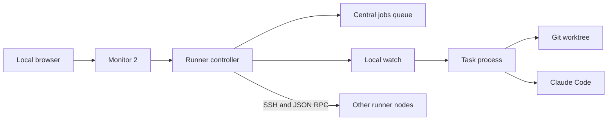

# Functions and architecture / Functies en architectuur

| Function | What it does | Where to look |
| --- | --- | --- |
| Single task | Starts a turn from a repository, records its outcome and preserves the worktree. Status, pause, send and stop are available via the CLI. | `runner2.cli`, `controller`, `taskproc` |
| Watch | Records a heartbeat, scans for interrupted tasks and advances allowed work. | `runner2.watch`, `osadapter` |
| Queue | Stores assignments, dependencies, holds, approvals, review status and dispatch. Enable it explicitly on the controller. | `runner2.jobs`, `riskpolicy` |
| Repository selection | Resolves configured repositories and inspects local or remote candidates. | `runner2.repos`, `config/projects.toml` |
| Chains | Runs bounded sequential tasks and can request a separate completion check. | `runner2.chains`, `gate` |
| Supervisor | Optionally judges chains, plans another bounded chain, or asks for human input. External supervision tracks project decisions and events. | `runner2.supervisor`, `supervision`, `dossier` |
| Open actions | Lists recorded human follow-ups separately from a task actively waiting for a reply. | `runner2.actions`, `actionreview` |
| Monitor | Serves local browser views for nodes, tasks, reports, queues and attention items. Interactive actions require an explicit startup flag and appropriate configuration. | `app/obf_monitor2` |
| Remote control | Routes known controller operations over SSH and exposes controller tools via MCP. A networked MCP service is outside the tested profile. | `runner2.remote`, `rpc`, `controller_mcp` |
| Integration | Source includes checks and workflow for integrating reviewed changes. Production integration and its approvals were outside this package's tests. | `integration_check`, `integration_workflow` |
| Operations | Source includes backup, transfer, recovery, notifications and rollout components. Components that refer to the original deployment are outside the supported profile. | `statebackup`, `cpbackup`, `handover`, `notifier` |

De controller bewaart taak- en wachtrijstatus. De monitor toont die status via adapters. Een uitvoermachine start taakprocessen met de eigen platformvoorziening. macOS gebruikt een aparte processessie, Ubuntu gebruikt systemd-gebruikerseenheden en Windows gebruikt eigen procesgroepen. De watch en monitor kunnen apart draaien. Stoppen van de monitor staat los van stoppen van een taak.

Het testprofiel gebruikt een lokale monitor en een geïsoleerde gegevensmap. Studio-specifieke netwerkroutes, storingsfeed, automatisch productieherstel en de oorspronkelijke afbeeldingen zijn uit het standaard startpad of uit de bundel gehaald. De bron bevat aanvullende beheermodules en verwijzingen naar de oorspronkelijke uitrol. Zie [verificatie](VERIFICATION.md) voor de ondersteunde claims.
